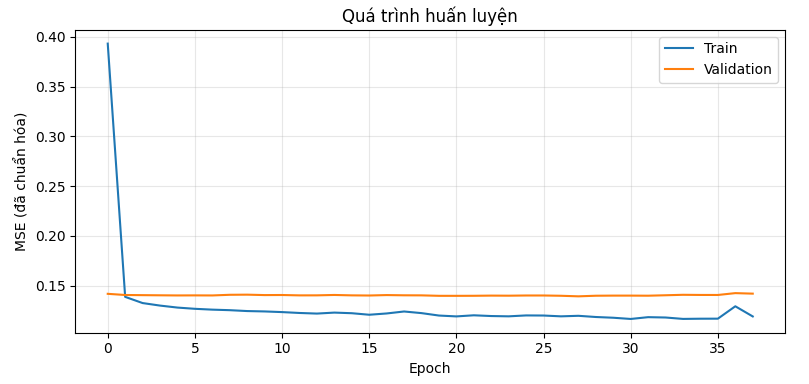
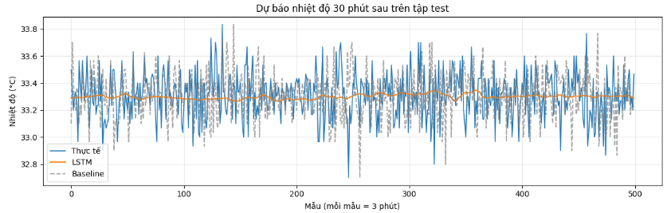
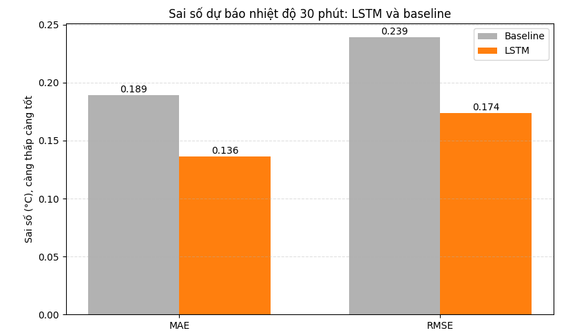

# Dự đoán nhiệt độ trong nhà bằng LSTM

Dự án dùng mạng nơ-ron hồi quy LSTM để dự báo nhiệt độ phòng sau 30 phút, dựa trên chuỗi lịch sử đo từ cảm biến gắn trên ESP32. Mô hình được so sánh với baseline đơn giản "giữ nguyên nhiệt độ hiện tại" trên tập test theo thứ tự thời gian.

## Mục lục

- [Kiến trúc dự án](#kiến-trúc-dự-án)
- [Phần cứng](#phần-cứng)
- [Firmware ESP32](#firmware-esp32)
- [Dữ liệu](#dữ-liệu)
- [Phương pháp](#phương-pháp)
- [Kết quả](#kết-quả)
- [Hạn chế](#hạn-chế)
- [Hướng dẫn chạy](#hướng-dẫn-chạy)

## Kiến trúc dự án

```
.
├── firmware/                   # Mã nguồn ESP32 (PlatformIO)
│   ├── platformio.ini
│   ├── src/
│   │   └── esp32.cpp           # Đọc cảm biến, FreeRTOS task, xuất CSV qua Serial
│   └── include/
├── data/
│   └── sensor_data.csv         # Dữ liệu đo thực tế
├── notebooks/
│   └── temperature_lstm_final.ipynb   # Tiền xử lý, huấn luyện, đánh giá
├── docs/                       # Biểu đồ kết quả
│   ├── training_loss.png
│   ├── forecast_vs_actual.png
│   └── metrics.png
├── models/
│   └── lstm_temperature.keras  # Mô hình đã huấn luyện
├── requirements.txt
└── README.md
```

## Phần cứng

| Linh kiện | Chân ESP32 | Vai trò |
|---|---|---|
| ESP32 DevKit | — | Vi điều khiển, đọc cảm biến, kết nối Wi-Fi và NTP |
| DHT22 | GPIO 4 | Nhiệt độ và độ ẩm |
| MQ-2 | GPIO 34 (ADC) | Khí gas (giá trị analog thô) |
| GP2Y1010AU0F | LED: GPIO 26, Output: GPIO 35 (ADC) | Bụi mịn |

## Firmware ESP32

Firmware được viết bằng Arduino framework trên FreeRTOS, build bằng PlatformIO.

- **`sensorTask`**: chạy đều mỗi 2 giây bằng `vTaskDelayUntil`, đọc DHT22, MQ-2 và trung bình 5 mẫu bụi. Mẫu lỗi của DHT được ghi là NaN.
- **`outputTask`**: lấy dữ liệu từ hàng đợi (`xQueue`) và in ra Serial dạng CSV: `timestamp,temperature,humidity,gas_raw,dust_ugm3`.
- Thời gian được đồng bộ qua NTP (`pool.ntp.org`, múi giờ UTC+7).
- Công thức bụi: điện áp đo được được quy đổi theo datasheet GP2Y1010AU0F, không dùng hệ số thử nghiệm.

Build và nạp:

```bash
cd firmware
pio run -t upload
pio device monitor -b 115200
```

Trước khi nạp, điền SSID và mật khẩu Wi-Fi trong `esp32.cpp`.

## Dữ liệu

File `data/sensor_data.csv` chứa các mẫu đo theo thời gian, với các cột chính:

- `timestamp`: thời điểm đo (ISO 8601, có múi giờ)
- `temperature`: nhiệt độ (°C)
- `humidity`: độ ẩm (%)
- `co2`, `voc`, `pm25`: các chỉ số khí và bụi

Dữ liệu gốc có thể được gộp theo khoảng 3 phút. Các khoảng trống không có mẫu bị loại bỏ.

## Phương pháp

### 1. Cấu hình thực nghiệm

| Tham số | Giá trị |
|---|---|
| Khoảng gộp mẫu (Resample) | 3 phút |
| Cửa sổ lịch sử (Window) | 30 mẫu (90 phút) |
| Thời gian dự báo (Horizon) | 10 mẫu (30 phút) |
| Đặc trưng đầu vào | `temperature`, `humidity`, `co2`, `voc`, `pm25`, `day_sin`, `day_cos` |
| Phân chia dữ liệu | Train 70% · Validation 15% (phần cuối của Train) · Test 30% |

### 2. Xử lý dữ liệu

- Chia theo thời gian, không xáo trộn, để tránh rò rỉ dữ liệu tương lai vào quá khứ.
- `StandardScaler` chỉ được fit trên tập train, sau đó áp dụng cho cả validation và test.
- Thời gian trong ngày được mã hóa bằng sin/cos để giờ 23:59 và 00:01 được xem là gần nhau.
- Cửa sổ trượt có nhãn hoặc đầu vào vắt qua ranh giới train/test sẽ bị loại bỏ.

### 3. Mô hình

```
LSTM(64, return_sequences=True) → LSTM(32) → Dense(32, relu) → Dense(1)
```

- Optimizer: Adam, hàm mất mát: MSE, số epoch tối đa: 100
- Batch size: 32
- EarlyStopping theo `val_loss`, patience = 10, khôi phục trọng số tốt nhất

### 4. Baseline

Baseline "giữ nguyên hiện tại": dự báo nhiệt độ sau 30 phút bằng chính nhiệt độ hiện tại. Đây là mốc tối thiểu để mô hình có ý nghĩa.

### 5. Đánh giá

Sai số được đo bằng MAE và RMSE theo đơn vị °C, sau khi đưa dự báo về thang đo gốc bằng `inverse_transform`.

## Kết quả

Kết quả trên tập Test, sai số đo bằng °C:

| Mô hình | MAE (°C) | RMSE (°C) |
|---|---|---|
| Baseline (giữ nguyên hiện tại) | 0.1889 | 0.2391 |
| **LSTM** | **0.1362** | **0.1739** |

Cải thiện so với baseline:

- Giảm MAE: **27.90%**
- Giảm RMSE: **27.29%**

### Biểu đồ

Quá trình huấn luyện (loss train và validation theo epoch):



Dự báo so với thực tế trên tập test:



So sánh sai số MAE và RMSE:



## Hạn chế

- Dữ liệu được thu thập trong một phòng và một khoảng thời gian ngắn, nên kết quả chưa đại diện cho các điều kiện khác.
- Sai số thấp (khoảng 0.14 °C MAE) phần lớn do nhiệt độ phòng thay đổi chậm. Cần kiểm thử thêm với các sự kiện thay đổi đột ngột như bật điều hòa hoặc mở cửa.
- Chưa có kiểm định nhiều lần chạy với các seed khác nhau, nên chưa biết độ dao động của kết quả.
- Cảm biến DHT22 có sai số đo khoảng ±0.5 °C, nên sai số dự báo phải được đọc trong ngưỡng này.

## Hướng dẫn chạy

### Yêu cầu

- Python 3.10 trở lên
- Các thư viện trong `requirements.txt`

```bash
pip install -r requirements.txt
```

### Chạy notebook

```bash
cd notebooks
jupyter notebook temperature_lstm_final.ipynb
```

Trong Jupyter, chọn **Kernel → Restart and Run All** để đảm bảo kết quả không phụ thuộc thứ tự chạy các cell. Notebook sẽ ghi biểu đồ vào `docs/` và mô hình vào `models/`.

## Công nghệ sử dụng

- ESP32, Arduino framework, FreeRTOS, PlatformIO
- Python, pandas, NumPy, scikit-learn, TensorFlow/Keras, Matplotlib
